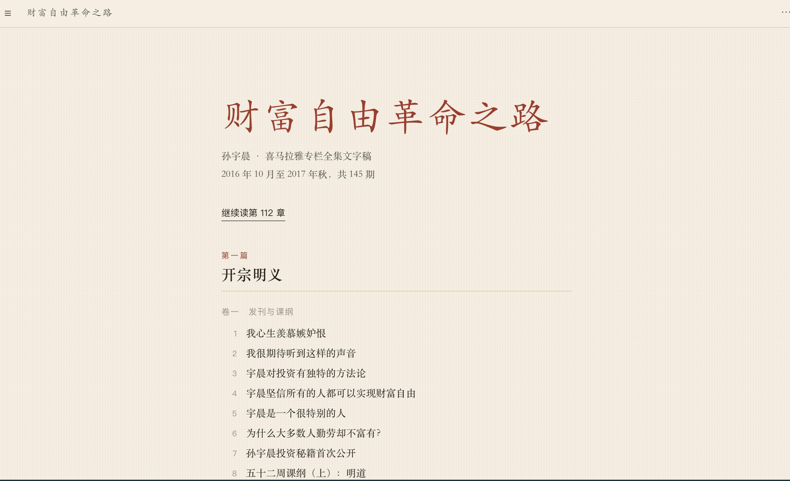

# 财富自由革命之路 · 网页书

把孙宇晨喜马拉雅专栏《财富自由革命之路》的 145 期文字稿，整理成一本可以在浏览器里连续读的书。

**在线阅读：** https://faust-cloud.github.io/sun-wealth-book/



## 为什么做这个

文字稿散落在 145 个 Markdown 文件里，每期开头都有一段重复的自我介绍，口述稿的长段落也不适合阅读。这个项目做了三件事：

1. **整理内容**：去掉每期开头的自我介绍和口头语，统一错别字，把过长的段落按句子拆开。
2. **编排成书**：按主题分成十三卷，从“什么是财富自由”一直到完结篇。
3. **做一个阅读器**：只放读书需要的东西，其余的都藏起来。

## 功能

- 目录按卷折叠，只展开正在读的那一卷
- 搜索标题和正文，命中处会高亮，可以逐处跳转
- 选中正文即可划线、写笔记，笔记能导出成 Markdown
- 自动记住读到哪一期
- 夜间模式
- 整本存为 PDF（A5 版式，每期另起一页）

| 快捷键 | 作用 |
| --- | --- |
| ← → | 上一期 / 下一期 |
| T | 收起或展开目录 |
| D | 夜间模式 |
| N | 打开笔记 |

## 本地使用

纯静态页面，不需要安装任何东西。下载仓库，用浏览器打开 `index.html` 即可。

```
index.html   阅读器（样式和逻辑都在这一个文件里）
data.js      全部文字稿
```

阅读进度和笔记都保存在浏览器本地，不会上传到任何地方。换电脑前请在「笔记」页导出备份。

## 来源与版权

- 文字稿整理自 [diverHansun/justin-sun-podcast-markdown](https://github.com/diverHansun/justin-sun-podcast-markdown)，由语音转写，个别人名和术语可能有误。
- 期数沿用原仓库的文件编号；约从第 101 期起，编号比节目口播少 1。
- 节目内容版权归孙宇晨及喜马拉雅所有，本项目仅供个人学习交流。如有侵权，请提 Issue，我会立即删除。
